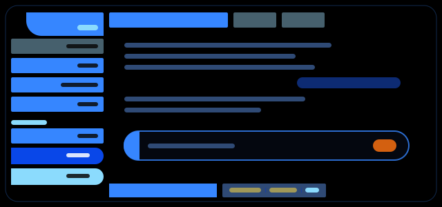

# dsh-theme-lcars

> [!WARNING]
> **Early, low-completion build — use with caution.**
> This theme is still work in progress: the look keeps changing, the implementation
> depends on DeepSeek Harness's internal class names and on runtime layout measurements,
> and parts of the UI may be misaligned or break outright after a DSH update, a window
> resize or a sidebar-width change. Try it in a profile you can afford to experiment in,
> and be ready to disable or remove the plugin.
>
> **早期实验版本，完成度较低，请谨慎使用。** 外观细节仍在反复调整；实现上依赖 DSH 内部的
> class 名与运行时测量，DSH 升级、窗口缩放或侧栏宽度变化时可能出现错位甚至失效。建议先在
> 一个可以随时折腾的 profile 里试用，并做好禁用/卸载插件的准备。

An LCARS console theme for [DeepSeek Harness](https://github.com/deepseek-ai) — the
Library Computer Access/Retrieval System interface Michael Okuda designed for
*Star Trek: The Next Generation*: black console panels, a flat navigation column of
full-width colour blocks, the uppercase **DEEPSEEK** brand block, compact rounded
session-header chips, a framed conversation surface, and a persistent bottom bar with a
pale stardate + clock readout.



## Status

| | |
| --- | --- |
| Version | `1.64.58` (build marker `lcars-build/1.64.58`) |
| Maturity | **experimental preview — low completion**, expect rough edges |
| Stability | layout is calibrated against the current DSH build; a DSH update can move or break parts of it |
| Scope | web interface only: one generated stylesheet, a small frame overlay and the settings page. No data, no network, no host services |
| Recover | remove the plugin in **Plugins** (or disable its row), then reload the page — the app returns to its own look |
| Conflicts | another theme plugin enabled at the same time fights this one |

What is known to still need polish: the exact geometry of the navigation blocks, the
session-header chips and the conversation frame has been iterated many times and may
still be off by a few pixels depending on window size, DSH version and font availability;
the settings page and the palettes are functional but their visual details are not final.
Treat screenshots in this repository as approximate.

## Features

| Part | What it does |
| --- | --- |
| Navigation column | Flat black column; each row is a two-label-line colour block (0.9 density, 39.6px), right-aligned labels, 8px gaps, hidden trailing icons, a pill-shaped right end |
| Brand block | Full-width block carrying the uppercase `DEEPSEEK` wordmark in the LCARS face, with the reference's large top-left arc |
| Session header | Session title, agent mode, subagent and background-task status as separate rounded blocks (25px tall, 8px corners), 5px under the conversation frame |
| Conversation frame | A 2px console outline with 4px corners around the conversation surface; the transcript is clipped to the same box, so scrolling text disappears at the frame |
| Bottom bar | A 184px frame band anchored on the column edge plus a pale readout box with the stardate and the clock |
| Settings page | **Settings › LCARS theme**: five colour series, seven per-block colours, the sidebar face and three console switches, saved in your profile |

The black console is the default: the browser half registers a dark theme and points the
appearance preference at it, so the app switches its own dark component styles (icons,
code themes, native chrome) instead of only being repainted. Turn *Black console* off to
follow Appearance, where light is a warm PADD-daylight variant of the same series.

## Install (experimental)

The package is a DSH bundle (`dsh.bundle.patch` inserts the `theme-lcars` row). It needs a
DSH build that projects a plugin's `Config` schema to the browser (`ctx.configForms`,
DSH ≥ 0.2); on older builds the theme still paints, but the settings page cannot save.

1. **Back up first.** The theme writes one config row (`theme-lcars`) into your profile;
   note the profile name so you can switch back or remove the plugin.
2. **From a checkout or the release tarball** — open **Plugins › Add plugin** and pick the
   package directory (the folder containing `package.json`), or install that directory
   from the agent side with `plugin_manager` `install_bundle`.
3. **From the plugin market** (when published) — install the market entry, then open
   **Settings › LCARS theme**.
4. Reload the page once after a manual re-install so the browser loads the new
   `client.js`.
5. **To roll back:** disable or remove the plugin in **Plugins**, then reload. Nothing is
   written outside your profile's settings.

## Settings

Everything lives on its own page, **Settings › LCARS theme**:

| Field | Default | Effect |
| --- | --- | --- |
| `palette` | `blueprint` | Colour series: `blueprint` (blue console), `tng` (2369), `classic` (2375), `early` (2357), `nemesis` (2379) |
| `colorFrame` … `colorSelected` | `''` | Per-block colour overrides (`#rrggbb`): frame, logo, primary, row, workspace, session, selected. Empty means “use the palette” |
| `sidebarFont` | `lcars` | Navigation face: `lcars` (LCARS GTJ3, uppercase), `condensed` (Oswald/Bahnschrift), `system` (the app's own font) |
| `surface` | `console` | `console` = black ship console (takes over the appearance preference); `auto` = follow Appearance |
| `chrome` | `true` | The console chrome: framed conversation area, block styling, console faces |
| `readout` | `true` | The stardate + clock readout box in the bottom bar |

Values go through DSH's own config form (`ctx.configForms`, namespace `theme-lcars`) and
are stored in the profile by the settings service — no `localStorage`, so the Desktop
host's random port per launch cannot reset them. All fields are `.volatile()`: a change
applies in the open page without a plugin restart.

### Palette roles

The column paints seven named roles, each with lettering that clears WCAG AA on its fill;
the `blueprint` series is the reference console's:

| Role | Blueprint | Element |
| --- | --- | --- |
| `frame` | status blue `#3686ff` | header blocks, conversation frame, bottom band |
| `logo` | status blue `#3686ff` | DEEPSEEK brand block |
| `primary` | trajectory slate `#46606d` | New session |
| `row` | scan blue `#3686ff` | Plugins / Automations / More and the profile block |
| `workspace` | initiate blue `#3686ff` | workspace row |
| `session` | distance blue `#0947e8` | session rows |
| `selected` | operations pale `#8bdbfd` | current session and active row |

## Fonts

- **LCARS GTJ3** for Latin console text, embedded as a `woff2` data URI in the generated
  stylesheet (a provenance copy is in `fonts/LCARSGTJ3.woff2`). It is an uppercase display
  face, so the console chrome uppercases its labels; its `…` glyph is a star, so a small
  `@font-face` claims only `U+2026` and takes a normal ellipsis from a local system face.
- **Glow Sans SC Condensed Bold** for Han, referenced by family name — install it locally
  if you want the console to use it for Chinese text.
- The theme faces apply to the **chrome only** (navigation column, panel top bar and
  chips, composer stats row, caption menu, bottom readout). The conversation surface, the
  composer card and code blocks keep the app's own fonts.

The embedded LCARS face is redistributed with the package; see [`LICENSE`](LICENSE) for
the third-party asset notes. If that is a problem for your build, drop the `@font-face`:
the stack then resolves the face from the system or falls back to Oswald.

## Development

Requirements: the Node that ships with DSH (any Node ≥ 18 for the offline harnesses) and,
for packaging, pnpm.

```powershell
# Style + behaviour harness: compiles the bundle, runs apply() against stub services,
# renders both components, checks the generated stylesheet (balanced, every palette
# variable declared), checks WCAG contrast over the palette pairs, and exercises the
# duplicate-mount / teardown / remount / failed-mount paths.
$env:ELECTRON_RUN_AS_NODE = '1'
& $env:DSH_NODE_EXECUTABLE test\check.mjs .

# Optional Host check: imports index.js without DSH_* variables (as the real Host
# process does) and projects the Config schema with DSH's own projector.
& $env:DSH_NODE_EXECUTABLE test\host-check.mjs <profile package dir> <dsh install dir>

# Dump the generated stylesheet for review.
& $env:DSH_NODE_EXECUTABLE test\tools\dump-stylesheet.mjs . out.css
```

Project rules: every client change bumps `BUILD_MARKER` in `client.js` **and** the
`package.json` version; the sheet carries an `lcars-build/<version>` marker so a stale
page can be told apart from a fresh build.

## Packaging

The directory is a publishable bundle — no `private` flag, exports for the client, the
locales and the icon, and a `files` allowlist that keeps tests, fonts and design sources
out of the tarball:

```powershell
pnpm pack        # → dsh-theme-lcars-<version>.tgz
tar -tf dsh-theme-lcars-<version>.tgz
```

The tarball ships `index.js`, `client.js`, `cordis.patch.yml`, `locale/*.json`,
`docs/DETAIL*.md` with the preview image, `icon.svg`, `README.md` and `LICENSE`.

## Notes and limits

- **Web interface only.** Nothing in the app's layout, data or behaviour is patched; the
  theme is one stylesheet plus a small overlay (bottom bar + conversation frame) and the
  settings page.
- **Measured against one DSH build.** Selection relies on `[class*="_…"]` fragments and on
  runtime measurements of the header, the sidebar and the conversation panel. A DSH update
  that renames those classes or changes those boxes can silently break parts of the look;
  the settings page keeps working.
- **One theme at a time.** DSH stacks theme token layers and every theme plugin injects its
  own sheet, so another theme plugin enabled at the same time competes with this one.
- The navigation column paints on the sidebar grid track only; it is hidden while the
  sidebar is collapsed or shown as a narrow-window drawer.
- LCARS, Star Trek and related marks belong to CBS/Paramount. This is a fan theme and ships
  no Star Trek artwork beyond generic geometric shapes; palette and shape references come
  from the [LCARS_CSS_Grid](https://github.com/hmt3design/LCARS_CSS_Grid) template and its
  documented LCARS sources.

## License

MIT for the code — see [`LICENSE`](LICENSE) for the third-party asset and trademark notes.
